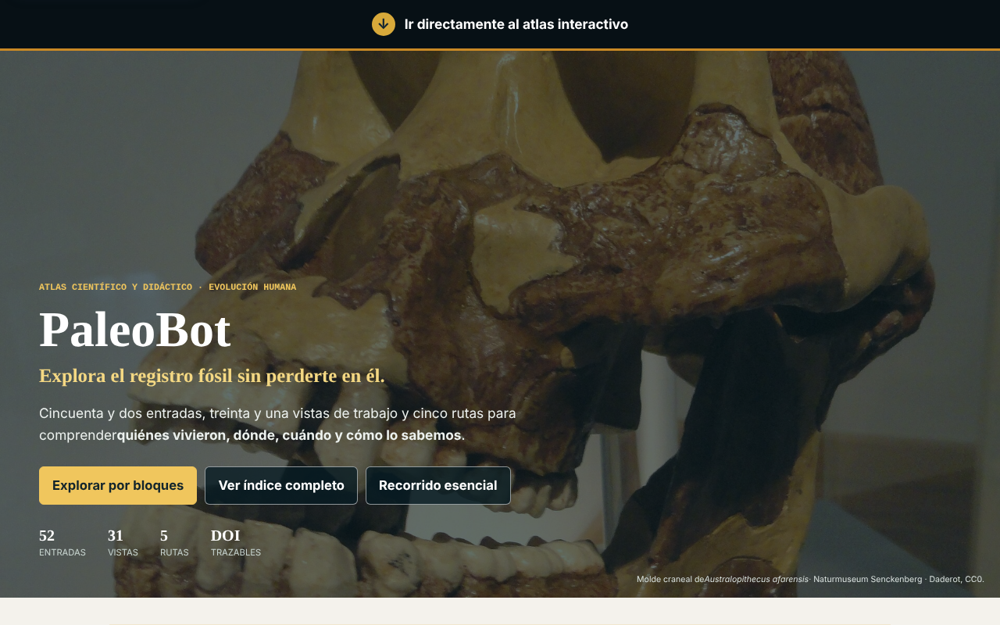
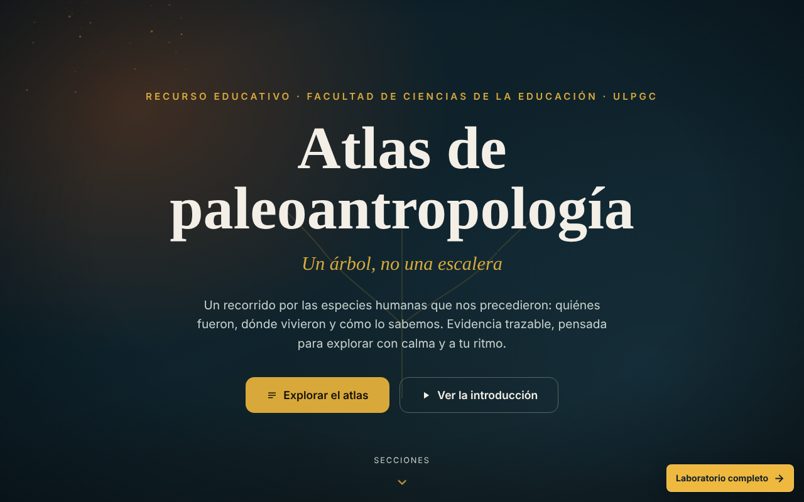
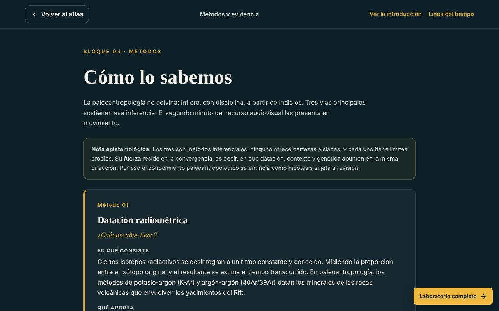
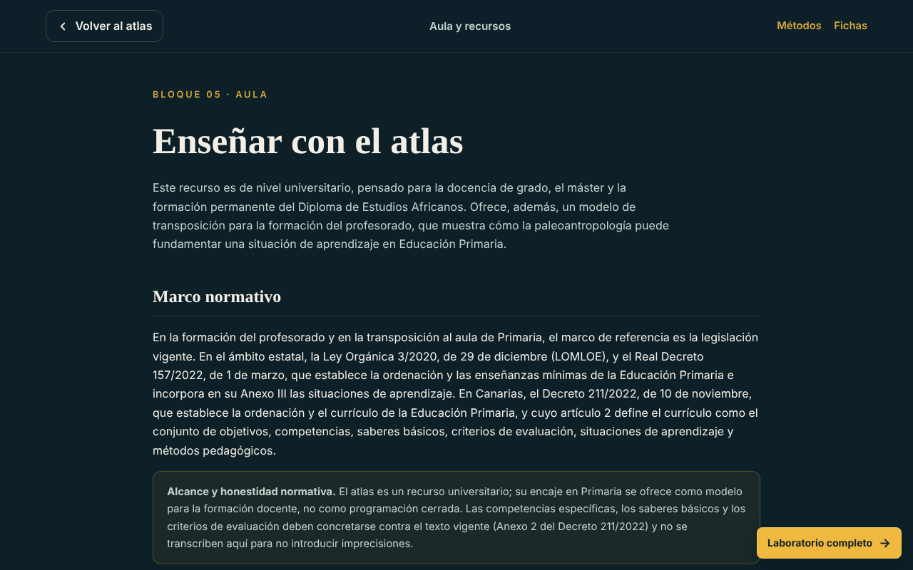

# Atlas PaleoBot v1.0 · guía visual, didáctica y científica

Atlas interactivo de paleoantropología de la Facultad de Ciencias de la Educación (FCEDU), Universidad de Las Palmas de Gran Canaria (ULPGC). Esta carpeta documenta la integración del paquete **Atlas-PaleoBot-v1.0-Moodle-IMS** en el repositorio. La aplicación está en [`/atlas/`](../../atlas/index.html) y se conserva tal como se recibió.

> **Estado: NO_GO para promoción docente.** Esta integración publica el recurso para su revisión; no acredita Moodle, lector de pantalla ni navegadores distintos de Chromium. Véase «Límites y estado».

## 1. Qué es, de un vistazo

| Elemento | Cifra declarada | Dónde se comprueba |
|---|---|---|
| Entradas de taxones | 52 | `atlas/data/taxones.json` (52 registros) |
| Vistas de trabajo | 31 | `atlas/index.html` (portada) |
| Rutas didácticas por perfil | 5 | `atlas/PROPUESTA-DIDACTICA.md` |
| Términos de glosario | 359 | `atlas/CAMBIOS-v1.0.md` |
| Modelos 3D institucionales enlazados | 5 (Smithsonian 3D Digitization) | `atlas/data/paleolab-3d.json` |
| Referencias con DOI en el recorrido | 37 enlaces `doi.org` | `atlas/recorrido/BIBLIOGRAFIA.md` |

Principio de diseño: **«un árbol, no una escalera»**. El atlas separa dato observado, inferencia, hipótesis y debate, y muestra el nivel de evidencia de cada ficha.

## 2. Cómo recorrerlo (visual)

El recurso tiene dos entradas complementarias:

| Entrada | Para qué sirve | Enlace |
|---|---|---|
| **Atlas interactivo** | Trabajo con cronología, mapa, filogenia, fichas, clima, datación, tafonomía, debates, glosario y PaleoLab. | [`atlas/index.html`](../../atlas/index.html) |
| **Recorrido guiado** | Lectura ordenada en diez páginas: introducción, atlas por bloques, cronología, territorio, parentesco, clima, métodos, fichas, aula y bibliografía. | [`atlas/recorrido/index.html`](../../atlas/recorrido/index.html) |

*Capturas de Chromium 1280 × 800 px el 24-10-2026 con el paquete servido en local. Las fotografías proceden de Wikimedia Commons con las atribuciones que muestra el propio atlas (p. ej., molde craneal de* Australopithecus afarensis*, Naturmuseum Senckenberg, Daderot, CC0).*

## 3. Uso didáctico

La propuesta completa está en [`atlas/PROPUESTA-DIDACTICA.md`](../../atlas/PROPUESTA-DIDACTICA.md); cada perfil incluye itinerario, objetivos, actividades, preguntas de pensamiento científico, evidencias de aprendizaje y criterios de evaluación. Resumen:

| Perfil | Entrada recomendada | Producto evaluable (ejemplos de la propuesta) |
|---|---|---|
| Estudiante de Educación Primaria | Cronología en nivel básico, ficha y mapa | Línea temporal justificada; comparación de dos taxones; respuesta que distinga dato e interpretación |
| Futuro profesorado | Centro docente, banco de recursos e itinerarios | Secuencia didáctica breve contrastada con cronología, mapa y fichas |
| Profesorado universitario y público general | Vistas de datación, tafonomía, debates y filogenia | Ruta justificada con evidencia y grado de consenso |

Preguntas que el recurso busca provocar: ¿qué dato permite ordenar dos taxones en el tiempo?, ¿qué sabemos con seguridad y qué es interpretación?, ¿cómo cambia una explicación cuando aparecen nuevas evidencias?

Marco normativo: la propuesta no fija una correspondencia curricular. Antes de usarla en aula debe cotejarse con el currículo vigente (Decreto 211/2022 de Canarias para Educación Primaria, según el Anexo 2 publicado por la Consejería; conviene cotejarlo con el BOC).

## 4. Rigor científico

- **Fuentes.** `atlas/recorrido/BIBLIOGRAFIA.md` reúne las referencias en estilo APA 7.ª con DOI (p. ej., Sutikna et al., 2016, *Nature*, 532, 366-369, https://doi.org/10.1038/nature17179; Hublin et al., 2017, *Nature*, 546, 289-292, https://doi.org/10.1038/nature22336; Richter et al., 2017, *Nature*, 546, 293-296, https://doi.org/10.1038/nature22335). El documento afirma que los DOI se han verificado en la fuente original; **esa comprobación no ha sido repetida en esta integración**.
- **Incertidumbre explícita.** Cada ficha lleva `nivelEvidencia` y `gradoConsenso`. `data/taxones.json` advierte de que son normalizaciones iniciales y de que el archivo es un piloto «no runtime»: la aplicación aún no lo consume en ejecución, y su origen declarado es `recorrido/datos.js`.
- **Debates abiertos.** El recurso incluye controversias reales (p. ej., el entierro y el arte rupestre atribuidos a *Homo naledi*, discutidos por Martinón-Torres et al., 2023) y no las presenta como consenso.
- **Imágenes y modelos 3D.** Las fotografías remiten a Wikimedia Commons con su licencia; los metadatos de los cinco modelos Smithsonian se indican como CC0 y los modelos 3D conservan las condiciones de la institución, y se abren en su fuente.

## 5. Límites y estado

Hallazgos de la auditoría de integración (24-10-2026), sin corregir porque la preparación conserva la lógica del paquete recibido:

| Ámbito | Hallazgo |
|---|---|
| Cifras | El atlas declara 52 entradas; el catálogo canónico del repositorio (`science/`, entrada v11) usa 50 identificadores. Hay que decidir si las dos entradas adicionales son un cambio deliberado antes de unificar. |
| Accesibilidad (axe-core 4.10.2, escritorio y móvil) | 1 crítico: `aria-allowed-attr` en `body` (se añade en ejecución); 1 grave: contraste en 20 iconos decorativos `.pb-pathway-icon`; 6 `<h1>` en la portada. Sin desbordamiento horizontal a 390 px. |
| Texto | En la portada faltan espacios en «comprender**quiénes**» y «de*Australopithecus*». |
| Seguridad | La CSP del `index.html` permite `'unsafe-inline'` en `script-src` y `style-src`, más laxa que la del resto del repositorio. Sin `eval` ni `new Function`; 228 usos de `innerHTML` no revisados línea a línea. |
| Privacidad | Al abrir el atlas se contacta con Google Fonts, cdnjs (Leaflet 1.9.4 con SRI), Wikimedia, servidores de teselas y el Smithsonian. Véase `atlas/POLITICA-PRIVACIDAD-DOCENTE.md`. |
| IMS | `imsmanifest.xml` correcto en integridad (168 archivos, todos presentes) pero mínimo: sin `schema`/`schemaversion` ni metadatos. |
| Moodle | No ejecutado. El kit R93 exige un candidato R92 con SHA-256 `b5223e16…`, distinto de este paquete. |
| Pruebas pendientes | Navegador real distinto de Chromium, lector de pantalla, Moodle, revisión disciplinar de las fichas. |

## 6. Procedencia

Huellas y origen en [`provenance/ATLAS_V1_IMPORT.json`](../../provenance/ATLAS_V1_IMPORT.json). Los 169 archivos de `atlas/` son idénticos a los del ZIP recibido; el ZIP no se incluye en el árbol (`.gitignore`). Para Moodle, genere el paquete IMS comprimiendo el **contenido** de `atlas/` (con `imsmanifest.xml` en la raíz del ZIP) y súbalo sin descomprimir.

## 7. Atribución y licencia

El repositorio no tiene licencia global (véase `LICENSE_STATUS.md`); esta integración no la asigna. Las imágenes y los modelos de terceros mantienen sus condiciones (`THIRD_PARTY_NOTICES.md`).
